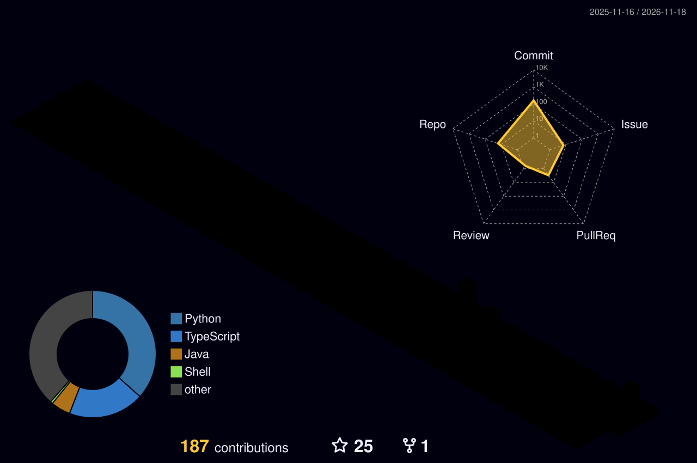

# Hi，我是 Quashy 👋 

> 软件应用开发者，关注 AI Agent、开发者工具和个人效率软件。

我用 Java 和 Spring Boot 做后端与 AI 应用，也用 TypeScript、React 和 Electron 把日常遇到的问题做成自己会用的工具。

目前关注软件应用开发、Java 后端和 Java + AI 应用方向的工作机会。

&emsp;
&emsp;
&emsp;

## 最近在做

最近我在试 Personal Agent 能接手哪些日常小事：把自家的猫做成桌宠，把微信读书的划线留在 Notion，也把记账变成一句话。

- [Pizza Cat Pets](https://github.com/Quashy/pizza-cat-pets) — 我把家里的猫「披萨」做成了写实版和像素版桌宠，也把用宠物照片制作桌宠的步骤放了进去。
- [微信读书 × Notion](https://github.com/Quashy/weread2notion-AI) — 把微信读书的划线和想法自动同步到 Notion，方便回看。这个版本基于 hodgekou 的同名项目。
- [Notion 财务系统](https://github.com/Quashy/notion-finance-ai) — 说一句买了什么、花了多少钱，就能让 Agent 分类记进 Notion，也能核对退款对应的原支出。

[从桌面养猫到一句话记账：我的三个 Personal Agent 小实践](https://quashy.github.io/2026/three-small-projects.html)

## 🛠️ 代表项目

### [OpenClaw4J](https://github.com/Quashy/OpenClaw4J)

我想让 Agent 换个会话也能找回之前记下的事，就用 Java 做了 OpenClaw4J。它把记忆和规则存在本地，也能调用工具和设置提醒。

### [知衍 KnowWeave](https://github.com/Quashy/OpenWiki)

团队资料散在不同文件里，查到结论后还得找它出自哪份文档。知衍把资料整理成可以互相跳转的 Wiki，提问时也能点引用查看原文。目前是 v1 Demo，主要流程已跑通，还在验证生成质量。

### [TextRelay](https://github.com/Quashy/text-relay)

临时给同事传一段提示词，发到聊天里过几天就难找。TextRelay 给每段文字一个四位分享码，对方在首页输入就能查看和复制。

### [并击 · 双拼打字练习](https://github.com/Quashy/bingji-shuangpin)

刚学双拼时，光看键位图很难记住每个键该用哪根手指按。我做了个练习网站，可以跟着指法提示练键位，再拿词组和文章练手。

[在线体验](https://quashy.github.io/bingji-shuangpin/) · [阅读设计思路](https://quashy.github.io/2026/from-quanpin-to-shuangpin.html)

## 🔭 正在开发

### 拾刊 · 本地优先 RSS 阅读器

面向 Windows 10/11 的本地优先 Electron RSS 阅读器，希望把订阅的作者与内容整理成更接近「刊物」的阅读体验。目前处于 MVP 开发阶段，仓库尚未公开。

`TypeScript` · `Electron` · `React` · `SQLite` · `Vite`

## ✍️ 技术写作

<!-- 博客 RSS 由 blog-post-workflow 自动同步，保留最近 99 篇 -->
<!-- BLOG-POST-LIST:START -->
- 📝 `2026-11-17` — [从桌面养猫到一句话记账：我的三个 Personal Agent 小实践](https://quashy.github.io/2026/three-small-projects.html)
- 📝 `2026-11-12` — [从零开始的金融生活](https://quashy.github.io/2026/finance-from-scratch.html)
- 📝 `2026-09-17` — [权限不是一串 if：从硬编码到 RBAC、ABAC 与 ACL](https://quashy.github.io/2026/from-if-else-to-rbac-abac-acl.html)
- 📝 `2026-08-31` — [消息先到，不代表事情先发生：MQ 乱序下的事件时间与状态回放](https://quashy.github.io/2026/handling-out-of-order-mq-messages.html)
- 📝 `2026-08-21` — [从流程图到状态机：我怎样落地一个审批需求](https://quashy.github.io/2026/lightweight-approval-workflow.html)
- 📝 `2026-08-17` — [一次登录，到底发生了什么：从 Session 到 SSO、OAuth 2.0、OIDC 与 SAML](https://quashy.github.io/2026/understanding-sso-auth-protocols.html)
- 📝 `2026-07-19` — [从全拼到双拼：我为什么做了「并击」](https://quashy.github.io/2026/from-quanpin-to-shuangpin.html)
- 📝 `2026-07-16` — [如何参与开源项目](https://quashy.github.io/2026/how-to-contribute-to-open-source.html)
- 📝 `2026-07-14` — [人生设计：探索你的现在](https://quashy.github.io/2026/designing-your-life.html)
- 📝 `2026-06-30` — [OpenCode GO 接入 CC Switch 指南](https://quashy.github.io/2026/opencode-go-ccw.html)<!-- BLOG-POST-LIST:END -->

[浏览全部文章](https://quashy.github.io/) · [订阅 RSS](https://quashy.github.io/feed.xml)

## 📈 GitHub 活动

<picture>
  <source media="(prefers-color-scheme: dark)" srcset="profile-3d-contrib/profile-night-rainbow.svg" />
  <source media="(prefers-color-scheme: light)" srcset="profile-3d-contrib/profile-gitblock.svg" />
  
</picture>

🎵 最近在听

  

